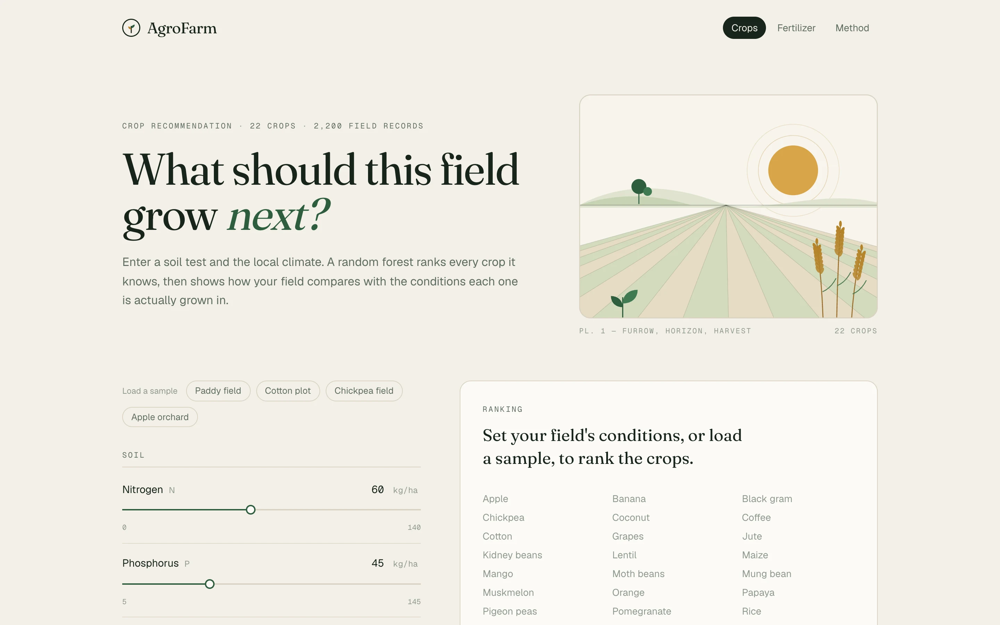
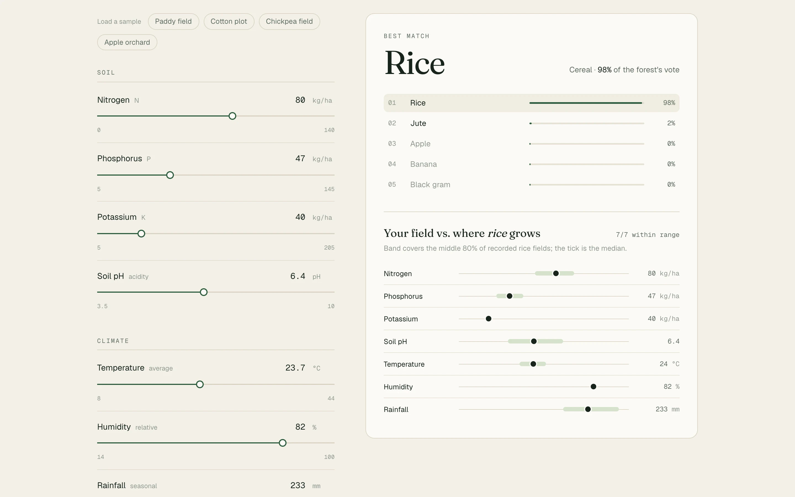
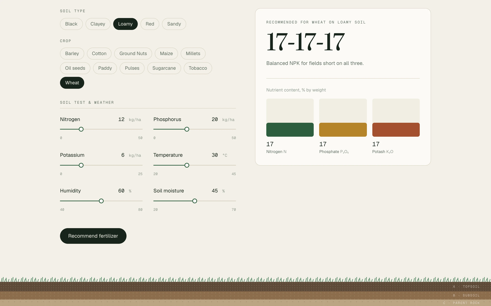

# AgroFarm

Crop and fertilizer recommendations from a soil test and local climate.

**Live → [agrofarm-orpin.vercel.app](https://agrofarm-orpin.vercel.app)**



## What it does

- **Crop ranking.** Enter N, P, K, pH, temperature, humidity and rainfall. A random forest ranks 22 crops.
- **Field comparison.** See how your field compares with the conditions each crop is actually grown in.
- **Fertilizer match.** Pick soil type and crop to get one of seven common N–P–K grades.

<p>
  
  
</p>

## Model

Trained on the [Crop Recommendation dataset](https://www.kaggle.com/datasets/atharvaingle/crop-recommendation-dataset) (2,200 records, 22 crops). Both models are scored on the same held-out split.

| Model | Test accuracy |
| --- | --- |
| v1 · Logistic regression | 95.2% |
| v2 · Random forest (100 trees) | **99.5%** |

The forest is exported from scikit-learn to JSON and evaluated in the Next.js API, so no Python server is needed.

## Stack

Next.js · TypeScript · Tailwind CSS · scikit-learn · Vercel

## Run locally

```bash
npm install
npm run dev
```

To retrain: `pip install -r ml/requirements.txt && python ml/train.py`

---

The original Streamlit version is on the [`legacy-streamlit`](https://github.com/malharinamdar/AgroFarm/tree/legacy-streamlit) branch.
